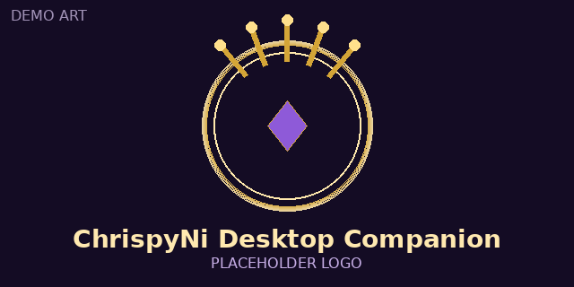
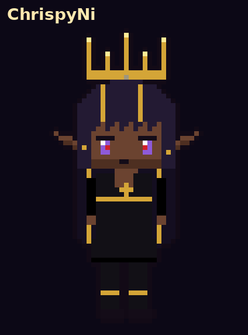
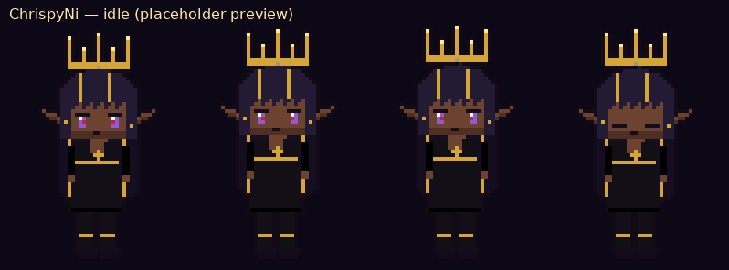

# 💛 ChrispyNi Desktop Companion

**ChrispyNi** on your Windows desktop.

## What it does

* Walks around your screen — drag her, drop her, she reacts.
* Chat in speech bubbles (offline replies).
* Mood and mana; hover to see mana. Magic costs mana; she can rest to recharge.
* Right-click for Info, Pat, or Feed (with cooldowns, crits, and a food limit).
* Summons props and furniture, uses them, and tidies unused ones.
* Watches videos with you; looks at a nearby cursor.
* Sleeps when you're AFK; wakes on mouse or keyboard.
* Throw physics when you toss her or a prop.
* Data-only mods (JSON + images).
* Auto-update from GitHub Releases when you accept it in her bubble.

## Download & run

1. Download **`ChrispyNi-Desktop-Companion-…-win.7z`** (or `.zip`) from [Releases](https://github.com/chrispyni/chrispyni-desktop-companion/releases).
2. Unpack it to any folder you can write to, e.g. `D:\Games\ChrispyNi`.
3. Run **`ChrispyNi Desktop Companion.exe`**.

> **SmartScreen:** the exe is unsigned. If Windows says "Windows protected your PC", click **More info → Run anyway**.

## Mods

Drop data-only mods (JSON + images) in the `mods\` folder. Chat replies live in `content\chat\library.json` (mods can add their own).

## Made with

✨ This project is made with Grok AI.

## License

All rights reserved. See [LICENSE](LICENSE).
