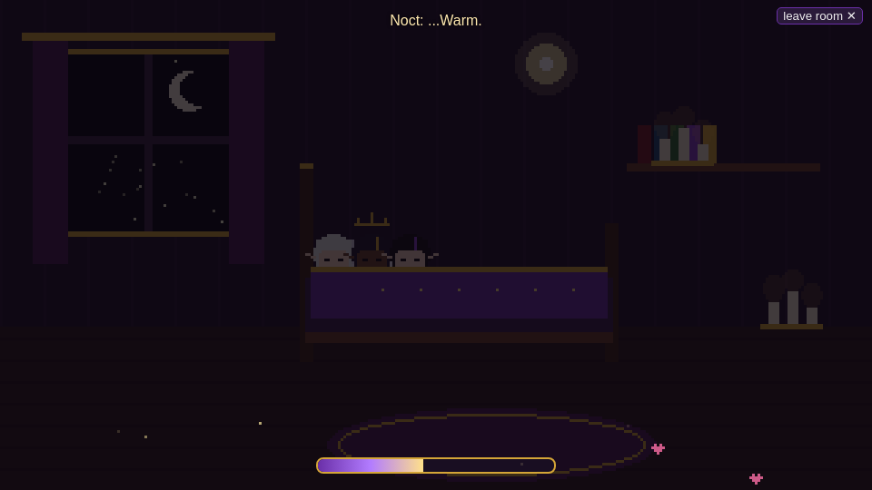
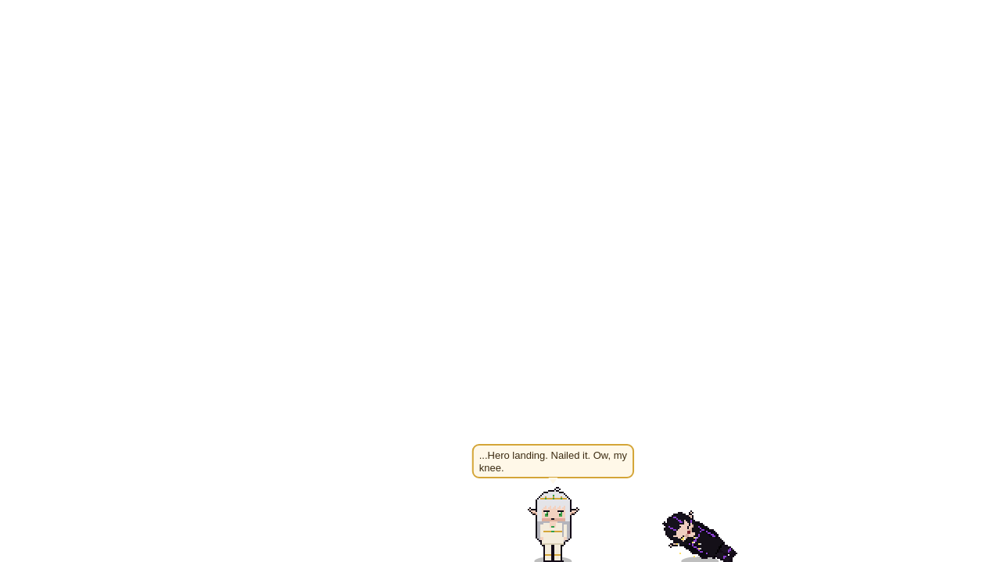
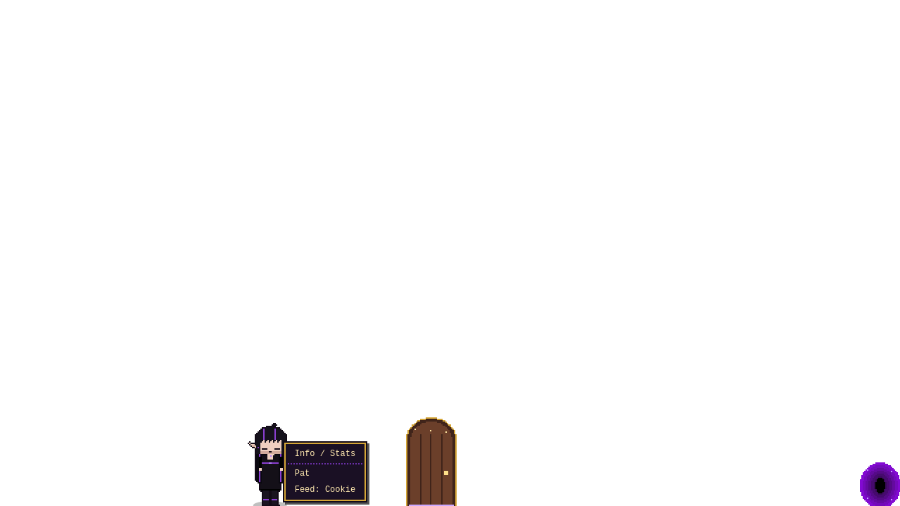

# 💛💜 Project Wives

Two pixel-art elf queens, **Nixie** and **Noct**, living on top of your Windows taskbar.

## What it does

* Nixie and Noct walk, run, sit, nap, pout, cast spells, wave, hug and kiss all over your screen. Drag them around, but drop them from too high and they land hard.
* You can chat with them, and they answer in speech bubbles. When you're busy they chat quietly with each other (`…`).
* Each wife has her **own mana**. Hover over her to see it. Magic costs mana: summoning furniture, levitating each other, crafting together, little gifts for ChrispyNi.
* When she's low, she rests in **our room**. She goes through a door, and you can click her mana bar to open it. Hugs, snacks and meditation help too.
* They have moods. Treat them well and they're sweet; annoy them and they get grumpy for a while (it passes).
* Right-click a wife for Info, Pat or Feed. Right-click a prop to delete it.
* ChrispyNi visits through a void portal, and some rare surprises happen now and then.
* Updates install themselves when you say yes.

| | |
|---|---|
|  |  |
|  |  |
|  |  |

## Download & run

1. Download **`ProjectWives-…-win.7z`** (or `.zip`) from [Releases](https://github.com/chrispyni/project-wives/releases).
2. Unpack it to any folder you can write to, e.g. `D:\Games\ProjectWives`.
3. Run **`Project Wives.exe`**.

Everything — saves, settings, mods, logs — stays inside that folder, like a game. Nothing goes to AppData. To move or back up, copy the folder.
Windows SmartScreen may warn because the app isn't signed: **More info → Run anyway**.

**Controls:** `Ctrl+Alt+W` chat (click outside or `Esc` to close) · drag to move · click to pet · right-click for the menu · hover for mana · `Ctrl+Alt+S` sleep · `Ctrl+Alt+D` debug menu · tray icon for everything else.

## Cheat codes

Type them in the chat box:

| Code | Effect |
|---|---|
| `MANAMANA` / `/fullmana` | Full mana |
| `ETERNALNIGHT` / `/infmana` | Infinite mana on/off |
| `GIMMEALL` / `/spawnall` | Summon every prop |
| `OURROOM` / `/room` | Go to our room |
| `BEDTIME` / `/sleep` | Sleep mode on/off |
| `COMEHOME` / `/visit chrispyni` | ChrispyNi visits |
| `SHOWMEBONES` / `/hitboxes` | Show hitboxes & states |
| `DEBUGMENU` / `/debug` | Open the debug menu |
| `/summon <prop>` · `/dismiss <prop\|all>` | Summon / remove a prop |
| `/mood <who> <mood>` · `/say <who> <text>` | Set a mood / make her talk |
| `/play <who> <animation>` · `/interact <who> <wave\|hug\|kiss>` | Animations & interactions |
| `FLOATY` · `CRAFTYQUEENS` · `LOVEYOU` / `/magic <who> <spell> [partner]` | Levitate, craft together, a lovely gift |
| `SPLAT` / `/drop <who> <0..1>` | Drop her from a height |
| `ZENMODE` / `/meditate [who]` | Meditate |
| `KNOCKKNOCK` / `/door [who]` · `TAKEMYWIVES` / `/take` | Door to our room · ChrispyNi takes them |
| `HEADPATS` / `/pat [who]` · `COOKIETIME` / `/feed [who] [food]` | Pat / feed |
| `/moodlvl <who> <-3..3>` · `/mana [who] <n>` · `SHOWMANA` | Mood level, mana, always show bars |
| `/speed <x>` · `/reload` · `/resetsave` · `/help` | Speed, reload content, reset save, list all |

The **debug menu** lists every animation, interaction, prop, spell, room and event so you can try them with one click. Anything new from mods shows up there automatically.

## Modding

Drop mods into the `mods` folder next to the exe: new characters, props, spells, rooms, dialogue or events, or changes to the built-in ones. They load live.
Sprite templates are in `templates` (see [SPRITES.md](SPRITES.md)). Food goes in `content/food`, and game rules (mood, mana, falls) are in `content/rules`.

## Mana

Each wife has 100 mana, and only magic uses it. Props cost 3–25, spells 6–10, and the door 5. Awake, she regains about 3 mana an hour. A hug gives +3 and a cookie +3. Meditating, when you've been away a while, refills her up to 50%. A rest in our room fills her completely. With everyday magic (about one spell or summon an hour), a full pool lasts the whole day.

## Issues & ideas

[Open an issue](https://github.com/chrispyni/project-wives/issues/new/choose) for a bug report, a feature request or an asset suggestion.

## License

© 2026 ChrispyNi. All rights reserved. You may view this repo and use the official releases. See [LICENSE](LICENSE).

---

✨ This project is made with Grok AI.
