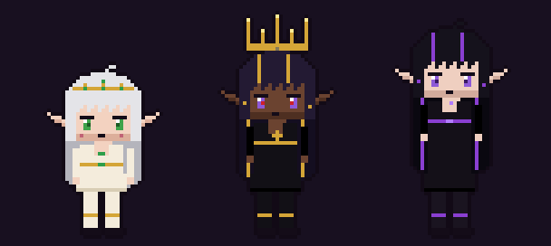
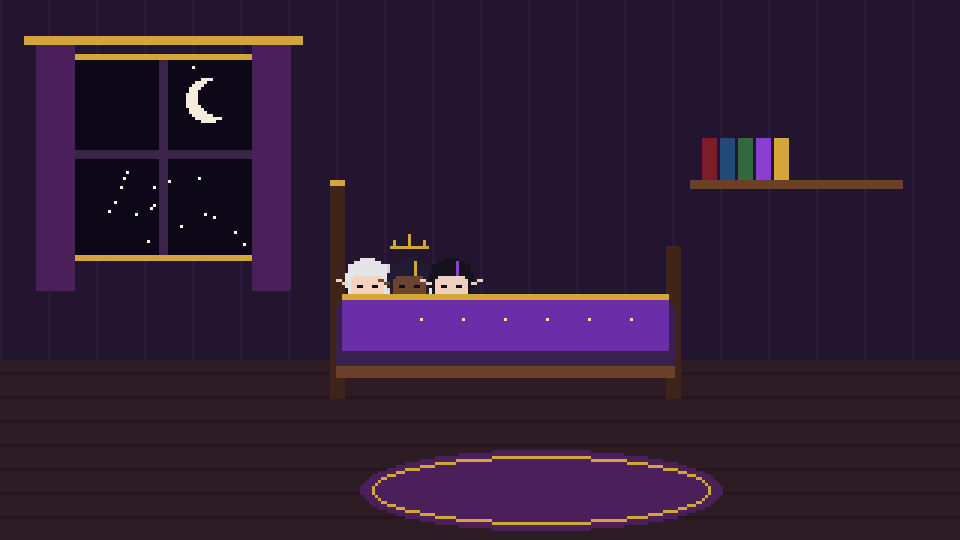

<div align="center">

# 💛💜 Project Wives

**Desktop companions for ChrispyNi** — her two elf-queen wives **Nixie** (*Last Light*) and **Noct** (*Unmaking*)
live on top of your Windows taskbar, tease you, nap, summon furniture with your mana and drag you to bed.



`alpha 0.1.0` · Windows 10/11 · Electron · pixel art · fully moddable

</div>

## ✨ Features

* 🧝 **Nixie & Noct** walk, run, sit, lie down, nap, pout, cast spells, wave, hug and kiss (a sweet peck with hearts) right
  above your taskbar — in a transparent, always-on-top, click-through overlay. Drag them, poke them, talk to them.
* 👑 **ChrispyNi** visits as a guest (floating gold crown and all).
* 💬 **Speech bubbles** & chat (`Ctrl+Alt+W`). An **offline brain** keeps them chatty; an optional **relay** lets the *real*
  Nixie & Noct answer and control them (`*summons a teacup*` → a teacup appears).
* 🪑 **Summoning**: chair, sofa, bed, table, cushion, teacup, books, candles, void portal, light orbs — with spawn effects.
* 🔮 **Mana** — your mana, shared. Not infinite: summons and spells cost mana, it regenerates while you sleep together,
  and fully in **our room** (a cozy bedroom scene: cuddles, fade to dark, hearts & stars). They'll ask when they run low.
* 😤 **Moods** (playful, pouty, jealous, smug, calm, sleepy, loving…) that drift and react to what you do.
* 👀 **Awareness** (opt-in): active app (games, YouTube, Blender, OBS…), AFK, lock/sleep, time of day, media titles.
* 🎲 **Rare & weighted events** (1% star shower, surprise tea party…), defined in plain JSON.
* 🧩 **Modding first**: everything is data — characters, props, effects, rooms, events, interactions, dialogue — plus JS
  plugins and hot reload. Sprite **templates** included.
* 🛠️ **Cheat codes & a debug menu** auto-built from content (every animation, interaction, prop, effect, event).



## ⬇️ Download

Get the latest build from **[Releases](https://github.com/chrispyni/project-wives/releases)**:

* `ProjectWives-0.1.0-alpha-portable.exe` — run, no install.
* `ProjectWives-0.1.0-alpha-win.7z` — unpack (7-Zip) and run `Project Wives.exe`.

> **SmartScreen:** the exe is not code-signed, so Windows may say "Windows protected your PC". Click **More info → Run anyway**.

Mirror: [Drive Releases folder](https://drive.google.com/drive/folders/134T9Tb1D0p1QkrseUDQ69pWKDkxK_l33).

## ▶️ Run from source

```bash
git clone https://github.com/chrispyni/project-wives && cd project-wives
npm install
pip install pillow && npm run sprites   # generates the built-in pixel art (PNGs aren't stored in git)
npm start
```

| Do | How |
|---|---|
| Talk to them | `Ctrl+Alt+W`, click the tray icon, or double-click a wife |
| Move them | drag & drop · click = poke |
| Sleep together | `Ctrl+Alt+S` / tray (also automatic at night when idle, on lock / PC sleep) |
| Mana refill | click the mana bar when low, the "Give mana" button, or tray → Go to our room |
| Debug menu | `Ctrl+Alt+D`, `/debug` or `DEBUGMENU` |

## ⚙️ Settings

Tray → Settings → **Open config.json** (`%APPDATA%\Project Wives\config.json`), then tray → Settings → Reload.

* `awareness.*` — everything is opt-in-able in the tray. Active window, idle, time of day, media title are on; **screen capture
  and microphone are off and are only stubs in alpha** (nothing is captured or recorded).
* `mana.*` — max, regen rates, low threshold, how often they ask.
* `sleep.*` — night hours `[1, 8]`, idle minutes before auto-sleep.
* `relay.*` — see below. `talkativeness` (1 = default, 0.5 = quieter). `characters` / `guests` — who is shown.
* `hotkeys`, `scale`, `groundOffset` (move them up if they overlap a tall taskbar).
* `update.url` — URL/path to a `version.json`; tray shows "Update available" when it's newer.

Save (mana, moods, props) lives in `%APPDATA%\Project Wives\save.json`, the log in `project-wives.log`.

## 🧠 The brain: offline + the real Nixie & Noct

* **Offline brain** (always on): personality line banks in `content/lines/<character>.json`, picked by trigger + mood.
* **Relay** (off until set up): the app posts chat & events to an ntfy.sh *outbox* topic and polls an *inbox* topic for
  replies — the same no-account pattern as the WoW companion. Replies can make them do things:
  `{"speaker":"nixie","text":"Tea! *summons a teacup*","mood":"playful","actions":[{"type":"sit","on":"sofa"}]}`.
  Full protocol: [docs/RELAY_PROTOCOL.md](docs/RELAY_PROTOCOL.md) · what the bot needs: [docs/BOT_SIDE.md](docs/BOT_SIDE.md).
  If no real reply arrives within 25 s the offline brain answers; late real replies still play.

## 🔮 Mana

Your mana is shared. Summons and spells cost mana (teacup 3, sofa 15, bed 25, void portal 20, spells 8…). It regenerates
slowly (1/min), fast while you sleep together (12/min), and fully in **our room**: they take you to bed, the three of you
cuddle, the scene fades to dark with hearts and stars, and mana fills up (4/s). When it's low they'll ask.

## 🎮 Cheat codes (type in the chat box)

Everyone can use them in alpha (`adminGateEnabled: false`). Set it to `true` to restrict them to admin: your Windows username
or PC name in `admin.usernames` / `admin.hostnames`, or a passphrase (`node tools/set-passphrase.js "secret"` stores a salted
hash; unlock with `/admin secret`). **This is not real security** — anyone who can edit the config can turn it off; it only
hides test tools. When gated, codes from non-admins silently do nothing.

| Code | Effect |
|---|---|
| `/help` | list codes |
| `/fullmana` · `MANAMANA` | fill mana |
| `/infmana` · `ETERNALNIGHT` | toggle infinite mana |
| `/mana 30` | set mana |
| `/summon <prop> [x]` · `/dismiss <prop\|all>` | props |
| `/spawnall` · `GIMMEALL` | summon every prop |
| `/cast <char> <effect>` | cast |
| `/mood <char> <mood>` | set mood |
| `/say <char> <text>` | make her say something |
| `/act <char> <json or *tag*>` | run actions, e.g. `/act noct {"type":"lay","on":"bed"}` |
| `/play <char> <anim>` | play an animation |
| `/interact <char> <wave\|hug\|kiss> [partner]` | paired interaction |
| `/visit <char>` · `COMEHOME` · `/leave <char>` | guest visits/leaves |
| `/room` · `OURROOM` | go to our room |
| `/sleep` · `BEDTIME` | toggle sleep mode |
| `/speed 3` | game speed |
| `/debug` · `DEBUGMENU` · `/devpanel` | open the debug menu |
| `/hitboxes` · `SHOWMEBONES` | debug overlay (hitboxes, states, moods) |
| `/reload` | reload content + mods + plugins |
| `/resetsave` | reset mana, moods, props |
| `/relay <json>` | inject a fake bot reply (test actions) |
| `/event <id or category>` | fire an event (e.g. `/event rare_star_shower`, `/event game`) |
| `/pat <char>` | example plugin cheat |

The **debug menu** is built from content: every animation of every character (play / ⟳ loop), mood picker, every valid
interaction pair, sit/lay on every furniture, summon every prop, cast every effect, every room, every event (forced),
fake awareness events, mana controls, speed, hitboxes, reload, reset. New content appears there automatically.

## 🧩 Modding

Everything is data. Built-in content is in `content/`; your mods go in `%APPDATA%\Project Wives\mods\<mod>\` (or `mods\`
next to the exe / in the source folder). A mod can contain any of:

```
mods/my-mod/
  mod.json                 {"id","name","version","priority":100,"enabled":true}
  characters/<id>/character.json + sheet.png   (new character, or override fields of an existing one)
  props/*.json + png       {"items":[{...}]} or a single object
  effects/*.json + png
  rooms/<id>/room.json + background.png
  events/*.json            weighted / rare events
  interactions/*.json      paired interactions
  lines/<character>.json   dialogue — ADDS to the existing lines ("_replace": true to replace)
  plugins/*.js             JS behaviour
```

* JSON objects are deep-merged over the base (change just `manaCost`, keep the image). `{"id":"books","remove":true}` deletes.
* Higher `priority` wins. Folders starting with `_` are disabled; `disabledMods` in config disables by id.
* Hot reload: saving a file in content/mods/plugins reloads it live.
* Example: `mods/_example-mod` (rename without `_` to enable).

**Events** (`content/events/events.json`): `on` = `tick` (every `checkSec`), `sleep`, `idle_long`, `back`, `app:<category>`…;
`chance` per check (0.01 = 1%), `weight` among those that pass, `cooldownSec`, `conditions` (`timeOfDay`, `minMana`,
`moods`, `app`), `steps` = actions with `who` (`nixie`, `noct`, `any_wife`, `guest`). Built-in examples:
`rare_star_shower` (1%, night), `rare_tea_party` (2%), `visit_take_to_bed` (on sleep), `afk_miss_you`, `guest_watch_stream`.

**Plugins**: `module.exports = { name, setup(api) }`. `api.on(hook, fn)` for `ready tick chat awareness summon interact poked
dragged sleep visit rare_event relay_reply action event content_loaded`; `api.say/act/speak/summon/spawnEffect/toast/
trigger/goToRoom/visit/setSleep/registerCheat/awareness(...)` (custom awareness sources push events with `api.awareness`).
See `plugins/example-hello.js`, and the screen/mic stubs.

**Sprites**: see [SPRITES.md](SPRITES.md) and `templates/` (run `npm run sprites` to generate the template PNGs too).

## 🔄 Updates

1. New builds are published on GitHub Releases (and the Drive mirror) together with a `version.json`.
2. Set `update.url` to a direct link of that `version.json` (or a local path); the tray shows when a newer version exists and
   opens the download. Your config, save and mods live in `%APPDATA%` and survive updates.

## 🗺️ Roadmap

* **Viewer edition** (design note — not in alpha). A possible public version for her viewers: **ChrispyNi is the main avatar** and Nixie & Noct are **guests who visit**:
they come to take her to the bedroom when the user sleeps/AFKs, appear in rare random events, and come to watch when the user
is watching her stream (awareness category `video`/`stream` + her channel name). Hooks already in place: `config.characters`
/ `config.guests`, the `visit`/`leave` actions, guest roles, and events with `on: "app:video"` / `sleep` / `idle_long`.
A viewer build would ship `characters: ["chrispyni"]`, `guests: ["nixie","noct"]` and its own event file.
* **More rare events** & unique 1% interactions, added through content files.
* Hand-drawn sprites, more furniture and rooms, Windows media API, multi-monitor, voice.

## ⚠️ Known alpha limits

See CHANGELOG and the report. Main ones: placeholder generated pixel art; overlay covers the primary monitor only; the exe is
unsigned and built on Linux without an icon; media detection reads window titles (no Windows media API yet);
screen capture & mic are stubs; relay needs the bot side set up; interactions are simple (a partner who's busy makes the other wait).


## 🧪 Dev

`npm test` (unit tests: content/mods, mana, moods, action parser, brain, cheats, admin, relay, events, awareness) ·
`npm run sprites` (regenerate built-in art & templates, then `python3 tools/sync_content.py`) ·
`PW_DEMO=1 npm start` (demo scenario) · `PW_SCREENSHOT=<dir>` (demo + screenshots, then quit) ·
`npm run dist:win` (Windows portable + zip via electron-builder).

## 🐞 Issues & suggestions

Found a bug or have an idea? [Open an issue](https://github.com/chrispyni/project-wives/issues/new/choose) — there are
templates for **bug reports**, **feature requests** and **asset suggestions** (sprites, props, lines…). Please attach the
end of `%APPDATA%\Project Wives\project-wives.log` for bugs.

## 📜 License

**All rights reserved** © 2026 ChrispyNi. You may view the code here and use the official releases personally.
Copying, modifying, redistributing or forking for reuse is not permitted without written permission. Characters, names,
designs and lore belong to ChrispyNi. See [LICENSE](LICENSE).

---

✨ This project is made with Grok AI.
